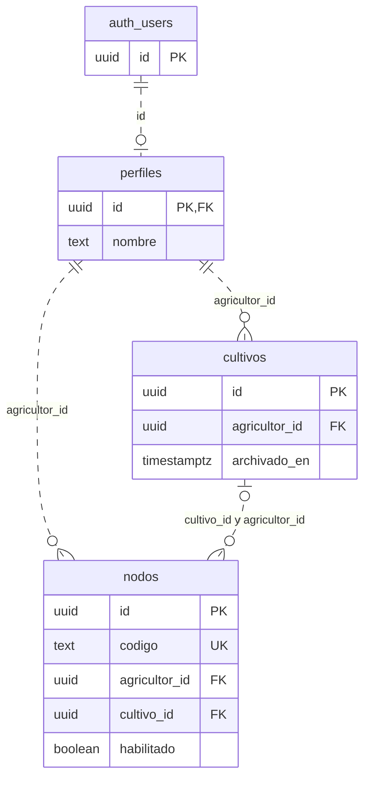
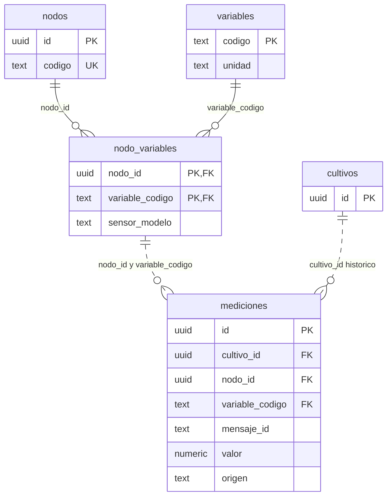
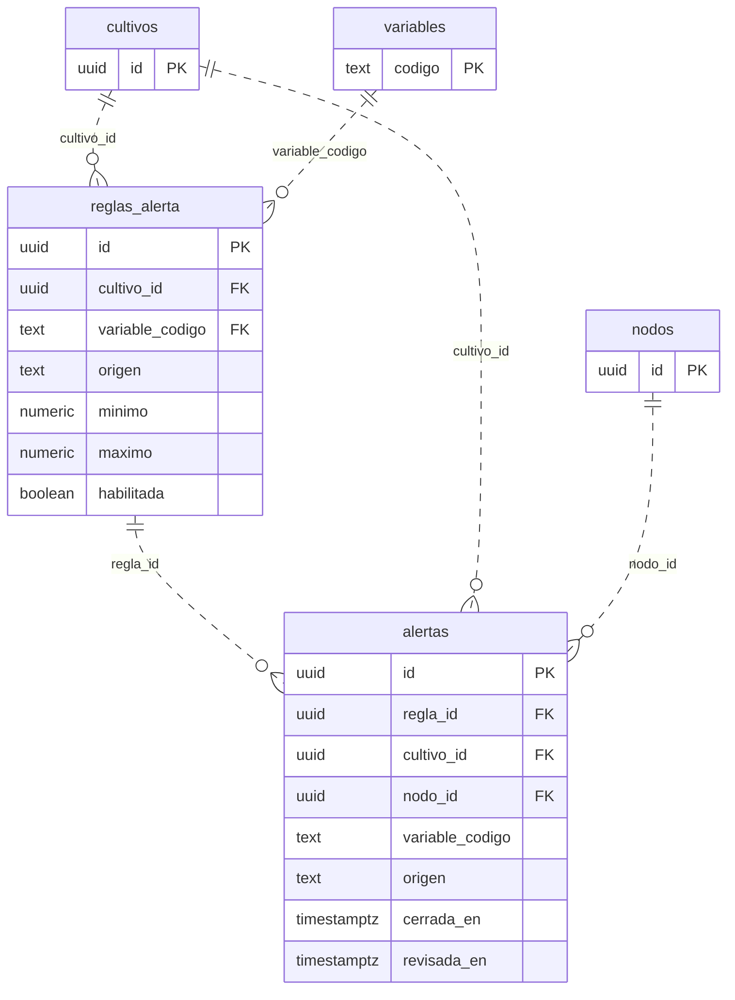
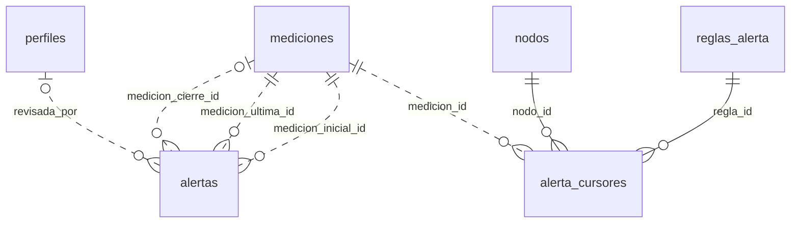
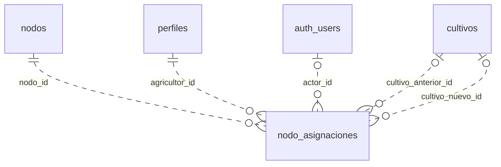

# Esquema de la base de datos de AgroVigía

Guía para desarrollar e integrar cambios. Fecha: 3 de noviembre de 2026.

Fuente: las seis migraciones de [supabase/migrations](../supabase/migrations/) y el listado de tablas compartido por Juan. Describe diez tablas de `public` y sus relaciones con `auth.users`. No se consultó la base remota en esta revisión; los cambios que solo existan en Supabase deben contrastarse con estas migraciones.

## Cómo leer y compartir esta guía

Versión visual: [archivo editable de draw.io](diagramas/AgroVigia-esquema.drawio) y [PDF para consulta](diagramas/AgroVigia-esquema.pdf). Ambos contienen siete páginas: portada, cuentas/nodos, capacidades/mediciones, asignaciones, reglas/episodios, evidencias y cursores. Abrir el `.drawio` en draw.io/diagrams.net y cambiar de página con las pestañas inferiores. Las diez tablas de `public` aparecen completas al menos una vez, y las 25 FK se distribuyen entre las páginas de detalle sin repetir relaciones. Las copias parciales se identifican como referencias de la misma tabla. Cada conector tiene un identificador FK y propiedades editables con la restricción SQL y sus columnas; los bloques de tabla incluyen también restricciones e índices en sus propiedades.

Los diagramas son vistas parciales del mismo esquema. Una tabla que aparece en dos diagramas es la misma tabla. Se muestran solo las columnas necesarias para explicar cada relación; el diccionario y la tabla de claves foráneas completan el detalle.

`PK`: clave primaria. `FK`: clave foránea. Una clave compuesta utiliza varias columnas juntas. En los diagramas, `||` significa exactamente uno, `o|` cero o uno y `o{` cero o muchos. Las restricciones operativas, como el máximo de dos nodos por cultivo en las RPC, se explican aparte.

GitHub puede mostrar los bloques Mermaid como diagramas al abrir este archivo. Para trabajar con la base, compartir también las migraciones: los diagramas no incluyen todo el código de funciones, triggers, índices y permisos. No hace falta compartir filas de datos ni claves de acceso para entender el esquema.

## 1. Cuentas, cultivos y nodos actuales

`auth_users` representa la tabla **`auth.users`**, administrada por Supabase Auth. El perfil usa el mismo UUID que la cuenta. Una cuenta Auth puede existir todavía sin perfil de AgroVigía.



Un nodo pertenece a una cuenta aunque esté libre. `nodos.cultivo_id = NULL` significa que no tiene cultivo actual. La FK compuesta exige que, cuando se vincule, el cultivo pertenezca a la misma cuenta. Crear o vincular mediante las RPC permite hasta dos nodos por cultivo; ese máximo no lo expresa la cardinalidad genérica del diagrama.

## 2. Sensores, capacidades y mediciones



`nodo_variables` declara qué puede medir cada nodo; no guarda lecturas. Un DHT22 aporta dos capacidades: `temperatura_aire` y `humedad_aire`. El LDR aporta `iluminacion_relativa`, expresada en `% relativo`, sin conversión a lux.

Una captura ambiental v2 genera **tres filas de mediciones**, con el mismo nodo y `mensaje_id`, y diferente variable. La FK de `mediciones` apunta al par `(nodo_id, variable_codigo)` de `nodo_variables`; no son dos referencias independientes.

`mediciones.cultivo_id` conserva el cultivo al que pertenecía la lectura cuando se guardó. Cambiar el vínculo actual de un nodo no mueve sus mediciones históricas. Los triggers impiden actualizar o borrar mediciones confirmadas.

## 3. Reglas y episodios de alerta



Una regla define límites para una variable, cultivo y origen. Una alerta es un **episodio** de un nodo fuera de esos límites; no es una copia de la regla ni una fila por cada mensaje recibido.

Solo puede haber una regla habilitada por `(cultivo_id, variable_codigo, origen)` y un episodio abierto por `(regla_id, nodo_id, origen)`. Las RPC conservan versiones de reglas anteriores al cambiar límites.

`cerrada_en = NULL` significa episodio abierto. `revisada_en = NULL` significa pendiente de revisión. **Marcar como revisada no cierra la condición.** La campana cuenta episodios reales abiertos y sin revisar.

## 4. Evidencias y control de evaluación de alertas



Las tres conexiones entre alertas y mediciones tienen funciones distintas: evidencia inicial, última lectura fuera de rango y lectura de cierre cuando existe. Las tres FK incluyen también `cultivo_id`, `nodo_id`, `variable_codigo` y `origen`: la evidencia debe pertenecer al mismo contexto que la alerta. La medición inicial y la última pueden ser la misma fila. Un cierre administrativo puede no tener medición de cierre.

`alerta_cursores` guarda la última captura procesada por regla, nodo y origen, para evitar evaluar de nuevo una captura duplicada o anterior. Es una tabla interna del evaluador; no almacena notificaciones ni se consulta desde la web. No tiene permisos de lectura para `authenticated`, aunque tenga RLS habilitado.

## 5. Historial de asignación de nodos



`nodos.cultivo_id` responde «dónde está asignado ahora». `nodo_asignaciones` responde «qué cambios de asignación quedaron registrados». Los dos enlaces a cultivos representan antes y después, y pueden ser nulos. `actor_id` referencia directamente `auth.users`, no `perfiles`; puede ser nulo para operaciones administrativas sin identidad Auth.

Los triggers generan este historial e impiden modificarlo o borrarlo. Un evento `estado_inicial` es una fotografía al aplicar la migración 0005, no la fecha original de instalación del dispositivo.

## Diccionario compacto de las diez tablas

Todos los nombres pertenecen a `public`. Los campos no marcados con `?` son `NOT NULL`; `?` indica que admiten `NULL`. Los UUID de `id` se generan por defecto, salvo `perfiles.id`, que procede de Auth.

| Tabla | Columnas y tipos |
|---|---|
| `perfiles` | `id uuid PK/FK`, `nombre text`, `creado_en timestamptz` |
| `cultivos` | `id uuid PK`, `agricultor_id uuid FK`, `nombre text`, `tipo text`, `area numeric(12,4)`, `unidad_area text`, `solicitud_id uuid`, `creado_en timestamptz`, `archivado_en timestamptz?` |
| `nodos` | `id uuid PK`, `codigo text UNIQUE`, `agricultor_id uuid FK`, `cultivo_id uuid? FK`, `habilitado boolean`, `creado_en timestamptz` |
| `variables` | `codigo text PK`, `nombre text`, `unidad text`, `valor_min numeric(12,4)?`, `valor_max numeric(12,4)?` |
| `nodo_variables` | `nodo_id uuid PK/FK`, `variable_codigo text PK/FK`, `sensor_modelo text`; PK conjunta `(nodo_id, variable_codigo)` |
| `mediciones` | `id uuid PK`, `cultivo_id uuid FK`, `nodo_id uuid FK`, `variable_codigo text FK`, `mensaje_id text`, `valor numeric(12,4)`, `tomada_en timestamptz`, `recibida_en timestamptz`, `origen text`, `metadatos jsonb` |
| `nodo_asignaciones` | `id uuid PK`, `nodo_id uuid FK`, `agricultor_id uuid FK`, `cultivo_anterior_id uuid? FK`, `cultivo_nuevo_id uuid? FK`, `actor_id uuid? FK`, `motivo text`, `realizado_en timestamptz` |
| `reglas_alerta` | `id uuid PK`, `cultivo_id uuid FK`, `variable_codigo text FK`, `origen text`, `minimo numeric(12,4)?`, `maximo numeric(12,4)?`, `habilitada boolean`, `creada_en timestamptz`, `desactivada_en timestamptz?` |
| `alertas` | `id uuid PK`, `regla_id uuid FK`, `cultivo_id uuid FK`, `nodo_id uuid FK`, `variable_codigo text FK`, `origen text FK`, `limite text`, `umbral numeric(12,4)`, `medicion_inicial_id uuid FK`, `medicion_ultima_id uuid FK`, `medicion_cierre_id uuid? FK`, `valor_inicial numeric(12,4)`, `valor_ultimo numeric(12,4)`, `abierta_en timestamptz`, `ultima_tomada_en timestamptz`, `cerrada_en timestamptz?`, `motivo_cierre text?`, `revisada_en timestamptz?`, `revisada_por uuid? FK` |
| `alerta_cursores` | `regla_id uuid PK/FK`, `nodo_id uuid PK/FK`, `origen text PK`, `tomada_en timestamptz`, `medicion_id uuid FK`; PK conjunta `(regla_id, nodo_id, origen)` |

En `alertas`, las marcas FK de variable y origen corresponden a las referencias compuestas de evidencia, no a una FK directa hacia `variables`. En `mediciones`, `mensaje_id` es `text` con formato UUID v4 validado por restricción, mientras que `id` sí es de tipo `uuid`. Las fechas son `timestamptz`; la web las presenta en horario de Bogotá.

## Mapa exacto de claves foráneas

Cada fila es una restricción, incluidas las compuestas. Este mapa evita depender del trazado de líneas del editor.

| Tabla de origen | Columna o conjunto de columnas | Tabla de destino | Columnas de destino |
|---|---|---|---|
| `perfiles` | `id` | `auth.users` | `id` |
| `cultivos` | `agricultor_id` | `perfiles` | `id` |
| `nodos` | `agricultor_id` | `perfiles` | `id` |
| `nodos` | `cultivo_id, agricultor_id` | `cultivos` | `id, agricultor_id` |
| `nodo_variables` | `nodo_id` | `nodos` | `id` |
| `nodo_variables` | `variable_codigo` | `variables` | `codigo` |
| `mediciones` | `cultivo_id` | `cultivos` | `id` |
| `mediciones` | `nodo_id, variable_codigo` | `nodo_variables` | `nodo_id, variable_codigo` |
| `nodo_asignaciones` | `nodo_id` | `nodos` | `id` |
| `nodo_asignaciones` | `agricultor_id` | `perfiles` | `id` |
| `nodo_asignaciones` | `cultivo_anterior_id` | `cultivos` | `id` |
| `nodo_asignaciones` | `cultivo_nuevo_id` | `cultivos` | `id` |
| `nodo_asignaciones` | `actor_id` | `auth.users` | `id` |
| `reglas_alerta` | `cultivo_id` | `cultivos` | `id` |
| `reglas_alerta` | `variable_codigo` | `variables` | `codigo` |
| `alertas` | `regla_id` | `reglas_alerta` | `id` |
| `alertas` | `cultivo_id` | `cultivos` | `id` |
| `alertas` | `nodo_id` | `nodos` | `id` |
| `alertas` | `revisada_por` | `perfiles` | `id` |
| `alertas` | `medicion_inicial_id, cultivo_id, nodo_id, variable_codigo, origen` | `mediciones` | `id, cultivo_id, nodo_id, variable_codigo, origen` |
| `alertas` | `medicion_ultima_id, cultivo_id, nodo_id, variable_codigo, origen` | `mediciones` | `id, cultivo_id, nodo_id, variable_codigo, origen` |
| `alertas` | `medicion_cierre_id, cultivo_id, nodo_id, variable_codigo, origen` | `mediciones` | `id, cultivo_id, nodo_id, variable_codigo, origen` |
| `alerta_cursores` | `regla_id` | `reglas_alerta` | `id` |
| `alerta_cursores` | `nodo_id` | `nodos` | `id` |
| `alerta_cursores` | `medicion_id` | `mediciones` | `id` |

## Restricciones que afectan a la integración

| Regla | Dónde se aplica |
|---|---|
| Reintentar el alta de un cultivo sin duplicarlo | UNIQUE `(agricultor_id, solicitud_id)` y comprobaciones de `crear_cultivo` |
| Un nodo solo tiene un cultivo actual de su misma cuenta | Columna nullable `nodos.cultivo_id` y FK compuesta con `agricultor_id` |
| Crear cultivo con uno o dos nodos propios, libres y habilitados; vincular sin superar dos | RPC de gestión, no un CHECK que cuente filas de nodos |
| No recibir nuevas mediciones ni vínculos en un cultivo archivado | Triggers y RPC; archivar conserva historial y libera nodos |
| No duplicar una variable del mismo mensaje de un nodo | UNIQUE `(nodo_id, mensaje_id, variable_codigo)`; la RPC comprueba además contenido y lote completo |
| Mantener evidencia de la misma variable, nodo, cultivo y origen | Tres FK compuestas de `alertas` hacia `mediciones` |
| No mezclar telemetría real y simulada | Campo `origen`, validaciones del canal y filtros de consultas/reglas |
| Regla con al menos un límite, y mínimo menor que máximo si están ambos | CHECK y RPC de reglas |
| Revisar y cerrar son operaciones distintas | Campos independientes; la RPC de revisión no cierra episodios |
| Metadatos LDR con ADC y método de conversión relativo | `mediciones.metadatos` es objeto JSON; la RPC ambiental valida su contenido |

## Acceso desde la aplicación y n8n

La lista de políticas RLS copiada por sí sola no describe todos los permisos. También existen `GRANT`, `REVOKE`, funciones y triggers en las migraciones.

| Quién | Lectura | Escritura de la aplicación |
|---|---|---|
| Web con sesión `authenticated` | Perfil, cultivos, nodos, capacidades, mediciones, asignaciones, reglas y alertas propios; catálogo `variables` compartido | Solo mediante las RPC autorizadas de abajo; sin INSERT/UPDATE/DELETE directo en estas tablas |
| n8n con credencial de servidor | SELECT concedido en tablas públicas de la aplicación, salvo `alerta_cursores` | RPC de ingesta y evaluación; sin escritura directa concedida en esas tablas |
| Evaluador dentro de PostgreSQL | Mediciones, reglas, episodios y cursores necesarios | Funciones con permisos controlados actualizan episodios y cursores |

Funciones para la web, ejecutables por `authenticated`:

| Operación | RPC y parámetros |
|---|---|
| Crear cultivo y asignar nodos | `crear_cultivo(p_nombre, p_tipo, p_area, p_unidad_area, p_nodos, p_solicitud_id)` |
| Editar datos del cultivo | `editar_cultivo(p_cultivo_id, p_nombre, p_tipo, p_area, p_unidad_area)` |
| Archivar cultivo | `archivar_cultivo(p_cultivo_id)` |
| Vincular nodo libre | `vincular_nodo(p_nodo_id, p_cultivo_id)` |
| Desvincular nodo del cultivo esperado | `desvincular_nodo(p_nodo_id, p_cultivo_esperado_id)` |
| Configurar o cambiar límites | `configurar_regla_alerta(p_cultivo_id, p_variable_codigo, p_minimo, p_maximo, p_origen)`; origen por defecto `real` |
| Desactivar regla | `desactivar_regla_alerta(p_regla_id)` |
| Marcar episodio revisado | `revisar_alerta(p_alerta_id)` |

Funciones de servidor, ejecutables por `service_role`:

- `registrar_lote_ambiental(p_topico, p_mensaje, p_recibida_en, p_acl_verificada, p_retenido, p_retencion_broker_desactivada)`: ingesta ambiental v2.
- `registrar_lote_dht22(...)`: misma firma de parámetros para compatibilidad v1.
- `evaluar_alertas_lote(p_nodo_id, p_mensaje_id)`: evalúa lecturas ya guardadas; no acepta valores ambientales elegidos por el navegador.

La web utiliza la clave pública de Supabase y la sesión del agricultor. Las claves de servidor permanecen en n8n. El alta administrativa de cuentas y dispositivos es distinta del vínculo que realiza el agricultor.

## Qué archivos compartir y cómo contrastar la base real

Compartir esta guía y **toda la carpeta `supabase/migrations/`**, en orden 0001 a 0006. Las migraciones contienen el esquema ejecutable, incluidas las funciones y restricciones. No deben ejecutarse de nuevo sobre el proyecto compartido que ya las tiene aplicadas; reproducirlas corresponde a una base de desarrollo nueva y preparada para Supabase Auth.

Si el compañero modificó la base directamente, puede obtener las FK actuales desde el SQL Editor con esta consulta de solo lectura y compararlas con el mapa anterior:

```sql
SELECT
  ns.nspname AS esquema,
  t.relname AS tabla,
  c.conname AS restriccion,
  pg_get_constraintdef(c.oid, true) AS definicion
FROM pg_constraint c
JOIN pg_class t ON t.oid = c.conrelid
JOIN pg_namespace ns ON ns.oid = t.relnamespace
WHERE c.contype = 'f'
  AND ns.nspname = 'public'
ORDER BY t.relname, c.conname;
```

Con las seis migraciones del repositorio, el resultado esperado es **25 claves foráneas**. Esta consulta comprueba relaciones, no diferencias de columnas, funciones o permisos. Los cambios nuevos de estructura deberían quedar en otra migración versionada, para poder revisarlos e integrarlos con n8n y la web.

`sugerencias_ia`, `sugerencia_mediciones` y `predicciones` aparecen en documentos de diseño anteriores, pero **no están creadas por estas seis migraciones**. No deben suponerse disponibles al desarrollar contra este esquema.
